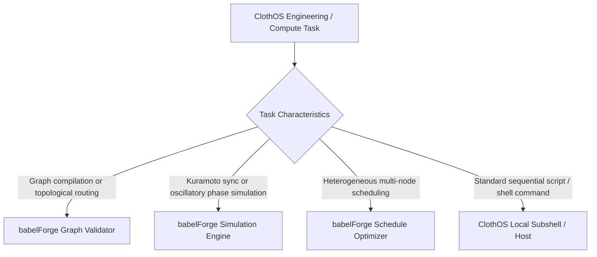

# AGENTS.md: ClothOS & babelForge Co-Reasoning Specification

## 1. Domain Ontology & System Mapping

ClothOS orchestrates distributed sovereign intelligence across heterogeneous silicon (Node 1 CUDA/OpenCL GPU and Node 2 APU/CPU). babelForge provides topological state-space formulation, algebraic topology, and dynamical oscillator models. When reasoning about or executing operations within this workspace, agents MUST ground abstract compute across this unified ontology:

| babelForge Primitive | ClothOS Substrate Mapping | Mathematical Formalism |
| :--- | :--- | :--- |
| **Connectome Graph ($G = (V, E)$)** | Distributed Compute Topology | $V = \{\text{Node 1, Node 2, PCIe, Edge}\}$, $E = \text{Interconnect Bandwidth (GB/s)}$ |
| **Coordinate Manifold ($\mathcal{M}$)** | Hardware Latency & Memory Tiers | 3D Spatial embedding $(x, y, z)$ mapped to VRAM $\rightarrow$ RAM $\rightarrow$ Network distance |
| **Coupled Oscillators ($\theta_i$)** | Worker Clock Phase & Task Cadence | Kuramoto phase vector $\vec{\theta} \in [0, 2\pi)^N$ representing pipeline synchronization |
| **Adjacency / Coupling ($A_{ij}$)** | Inter-Worker Communication Fabric | Bandwidth-weighted affinity matrix $A_{ij} \in [0, 1]$ |
| **Phase Coherence ($R_{ij}$)** | Task Synchronization State | $R_{ij} = \cos(\theta_i - \theta_j)$; order parameter $R = |\frac{1}{N}\sum_j e^{i\theta_j}| \in [0, 1]$ |
| **Simplices & Cliques ($\sigma \in \Delta$)** | Atomic Co-Execution Bundles | Cliques of workers requiring zero-jitter lockstep barriers |
| **Topological Cavities ($H_k$)** | Deadlock Hazards & Routing Voids | Betti numbers $\beta_k = \text{rank}(H_k)$ representing cycle deadlocks |
| **Pharmacological Vectors $(\alpha, \delta, \chi, \rho)$** | Task Steering & Throttling Tensors | $\alpha$: Frequency boost, $\delta$: Contention dampening, $\chi$: Stochastic jitter, $\rho$: Ratchet coupling |

---

## 2. Mathematical Axioms & Strict Invariants

Agents reasoning about ClothOS workloads through babelForge MUST adhere to these non-negotiable axioms:

1. **Deterministic State Transitions (Zero Hallucinated Math)**:
   - All matrix operations, spectral decompositions, phase synchrony calculations, and topological metrics MUST be computed programmatically via verified scripts or babelForge MCP tools.
   - Hallucinated or hand-waved matrix arithmetic is strictly forbidden. If an agent states $R > 0.85$, it MUST invoke `validate_graph_invariants` or calculate it via NumPy.

2. **Kuramoto Phase Dynamics**:
   Every distributed oscillator/node follows the continuous differential equation:
   $$\frac{d\theta_i}{dt} = \omega_i + \frac{K}{N}\sum_{j=1}^N A_{ij}\sin(\theta_j - \theta_i) + \xi_i(t)$$
   - $\omega_i$: Intrinsic clock frequency of node $i$.
   - $K$: Global coupling coefficient ($K \ge 0$).
   - $A_{ij}$: Normalized communication fabric adjacency.
   - $\xi_i(t) \sim \mathcal{N}(0, \sigma^2)$: Thermal/network stochastic noise.

3. **Topological Boundary Conservation**:
   For any simplicial complex $C_*$, the boundary operator $\partial$ strictly satisfies:
   $$\partial_{k} \circ \partial_{k+1} = 0$$
   The Euler characteristic of any task graph is bounded by $\chi = \sum_{k=0}^d (-1)^k c_k = \sum_{k=0}^d (-1)^k \beta_k$.

4. **Lipschitz Continuity & Stability**:
   Every state update operator $T: \mathcal{M} \to \mathcal{M}$ must satisfy the contraction condition $\|T(x) - T(y)\| \le L \|x - y\|$ with $L < 1.0$ (Banach fixed-point attractor).

---

## 3. Execution Routing Matrix

ClothOS task delegators and agent loops MUST automatically route workloads according to this decision matrix:

- **Offload to babelForge**:
  1. Multi-node task placement across RTX 3060 (12GB) and RX 580 (8GB).
  2. High-dimensional topological validation of task DAGs.
  3. Continuous oscillator phase synchronization across Node 1 & Node 2.
  4. Vector state transitions with $(\alpha, \delta, \chi, \rho)$ steering.
- **Retain on ClothOS Host**:
  1. Direct file IO, git commits, terminal subshell processes.
  2. Standard Python/pip installations.
  3. Unit test execution via pytest.
