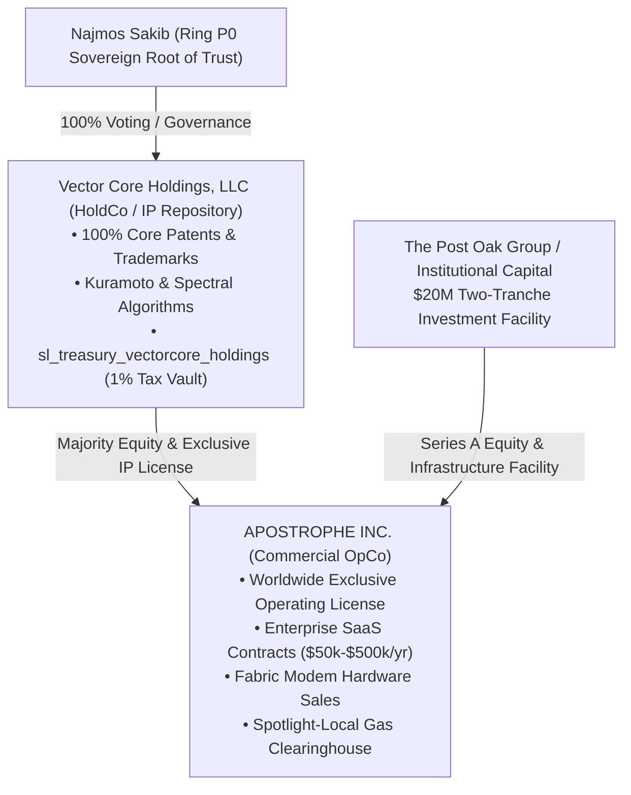
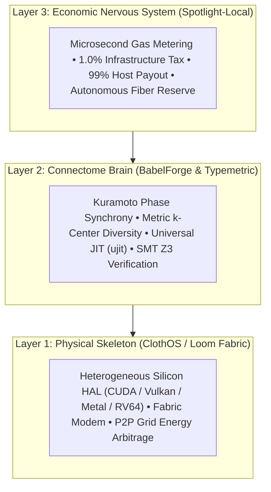

# APOSTROPHE INC.
## The Sovereign Compute Utility: Turning Stranded Energy into Distributed AI Infrastructure
### Institutional Series A Pitch Deck & Capital Formation Strategy

**Operating Entity (OpCo):** Apostrophe Inc.  
**Sovereign HoldCo & IP Repository:** Vector Core Holdings, LLC  
**Founder & Sovereign Architect (Ring P0):** Najmos Sakib  
**Target Counterparty:** Paul Clough, Senior Vice President of Capital Markets, The Post Oak Group  
**Target Facility:** $20,000,000 USD (Phased Two-Tranche Equity & Infrastructure Debt Facility)  
**Date:** November 2026  
**Classification:** Confidential — Prepared for Qualified Institutional & Infrastructure Investors  

---

## Executive Summary & Strategic Overview

Artificial intelligence and high-performance computing are colliding with the thermodynamic and economic limits of the centralized cloud. Hyperscalers (AWS, Azure, GCP) charge 300% to 800% markups on silicon FLOPs, suffer 30ms–80ms transit latency, and face gridlock as regional power grids run out of transmission capacity.

Simultaneously, renewable power producers across ERCOT and West Texas face severe **negative pricing and grid curtailment** because physical high-voltage lines cannot transmit stranded daytime solar and nighttime wind to urban load centers.

**Apostrophe** is the cyber-physical solution: a vertically integrated compute utility that turns **stranded energy directly into sovereign, high-margin AI compute**.

Instead of pitching fragmented software tools, Apostrophe presents **a single, vertically integrated biological computing platform** structured across three anatomical layers:
1. **The Physical Body (ClothOS / Loom Fabric):** Orchestrates heterogeneous silicon (NVIDIA CUDA, AMD Vulkan, Apple Metal, RISC-V) directly at the power generation site and across leased dark fiber.
2. **The Brain & Connectome (BabelForge / Typemetric-JIT / ujit):** Mathematical compiler enforcing Kuramoto phase synchronization, metric $k$-center geometric diversity, and sub-0.1ms JIT kernel synthesis to eliminate clock drift and cache thrashing.
3. **The Economic Nervous System (Spotlight-Local):** Microsecond gas settlement ($1.00 = 1,000 gas units) that pays 99.0% net revenue to compute hosts while capturing a 1.0% platform gas tax into an Autonomous Infrastructure Reserve that programmatically pays for physical dark fiber leases.

---

## Corporate Governance: The Apostrophe Structure

To give institutional investors clean legal comfort while protecting foundational IP and sovereign control:



---

## The 12-Slide Institutional Pitch Deck

---

### Slide 1: The Macro Crisis — The Cloud Hits the Energy Wall

#### Headline
**The 20-Year Centralized Cloud Experiment Has Reached Its Thermodynamic Ceiling.**

#### Key Industry Friction Points
1. **The Megawatt Grid Crisis:**
   - AI clusters require 50MW to 500MW per campus. Regional utilities are quoting **4-to-7 year interconnection delays** for new data centers.
   - Traditional data center funds spend **$10M to $20M per megawatt** on poured concrete, cooling towers, and diesel backup generators.
2. **The Stranded Renewable Energy Paradox (The Texas / ERCOT Reality):**
   - West Texas wind and solar produce massive surplus power during off-peak hours.
   - Due to transmission bottlenecks, power generators regularly experience **negative power pricing** (paying the grid to take electrons) or mandatory curtailment.
3. **Extractive Cloud Economics:**
   - Centralized clouds charge $2.50 to $4.50/hour for GPU compute that depreciates at $0.35/hour.
   - Enterprises surrender 40% to 60% of their operating cash flow to centralized cloud rental.

> *“Data centers are running out of power, while power generators are throwing away electricity. The bottleneck is physical transmission.â€*

---

### Slide 2: The Solution — Apostrophe

#### Headline
**The Sovereign Compute Utility: Data Centers Without Concrete.**

#### The Core Breakthrough
Apostrophe deploys edge compute directly behind the meter at power generation substations, commercial buildings, and enterprise facilities. It interconnects distributed heterogeneous silicon via leased commercial dark fiber (operating at 4.897 µs/km).

#### The Anatomy of Apostrophe


- **Cheaper:** 50% to 65% lower cost than AWS/Azure by eliminating data center concrete CapEx.
- **Faster:** Sub-5ms latency over local fiber and 5G mmWave versus 40ms–80ms public internet transit.
- **Sovereign:** Air-gapped Torque Scrubber keeps sensitive corporate and defense data within the local perimeter.

---

### Slide 3: The Energy-to-Compute Arbitrage Engine

#### Headline
**Converting Stranded West Texas Megawatts into High-Margin AI FLOPs.**

#### How It Works: Behind-the-Meter Power Arbitrage
```
[ Renewable Generator (Wind/Solar) ] 
                 │
                 ├─────────► Transmission Grid (Congested / Negative Pricing) ──► Lost Revenue
                 │
                 ▼
[ ClothOS Edge Compute Pods (Behind-the-Meter) ]
                 │
                 ▼ Dynamically activates batch AI training / molecular simulation
[ High-Margin Spotlight-Local Compute Gas ($1.00 / 1,000 Gas Units) ]
```

1. **Autonomous Curtailment Sensing:** ClothOS monitors local grid telemetry and nodal pricing in real time.
2. **Dynamic Workload Shifting:** When power prices drop below $0.02/kWh or turn negative, ClothOS instantly schedules compute-intensive workloads (LLM training, genomic scoring, molecular simulation).
3. **Monetization Spread:** Electricity that would have yielded $0 (or negative revenue) produces compute billed at market rates, delivering **80%+ gross operating margins**.

---

### Slide 4: Why Vertical Integration is Our Unfair Moat

#### Headline
**Why You Cannot Decouple the Engine, the Transmission, and the Fuel.**

Generic advisors caution against vertical integration because they confuse operational sprawl with architectural necessity. In foundational computing, vertical integration is the only path to a defensible monopoly:

```
┌──────────────────┬────────────────────────────────────────────────────────────┬───────────────────────────────────────┐
│ System Layer     │ If You Use Off-the-Shelf Third Parties...                  │ Apostrophe's Vertically Integrated Advantage│
├──────────────────┼────────────────────────────────────────────────────────────┼───────────────────────────────────────┤
│ Physical Silicon │ Tied to single-vendor NVIDIA price gouging & 52-week lead  │ Heterogeneous HAL: CUDA, AMD Vulkan,  │
│ (ClothOS)        │ times.                                                     │ Apple Metal, and RISC-V unified.      │
├──────────────────┼────────────────────────────────────────────────────────────┼───────────────────────────────────────┤
│ Compiler / Math  │ Heterogeneous nodes suffer clock drift, type thrashing,    │ BabelForge Kuramoto synchrony and     │
│ (BabelForge)     │ and memory race conditions.                                │ Metric k-Center keep nodes locked.    │
├──────────────────┼────────────────────────────────────────────────────────────┼───────────────────────────────────────┤
│ Economic Rail    │ Stripe/banking rails take 3% + $0.30 with 3-day ACH delay; │ Spotlight-Local microsecond gas       │
│ (Spotlight-Local)│ cannot meter microsecond compute bursts.                   │ settles 1,000 gas units per $1.00.    │
└──────────────────┴────────────────────────────────────────────────────────────┴───────────────────────────────────────┘
```

> *“Just as Apple had to build Apple Silicon, macOS, and the App Store together to beat the PC, Apostrophe integrates the silicon abstraction, compiler math, and settlement rails to create an unbreakable moat.â€*

---

### Slide 5: The Connectome Compiler (BabelForge, Typemetric & ujit)

#### Headline
**Patented Mathematics That Turn Chaos into Coherence.**

Distributing compute across heterogeneous chips (NVIDIA GPU + AMD APU + ARM CPU) normally crashes because chips run on different clocks and lose cache locality. Apostrophe solves this at the mathematical layer:

1. **Kuramoto Phase-Locking:**  
   Quantizes angular clock phases into dozenal base-12 integer steps. Nodes synchronize dynamically at $R > 0.85$, eliminating floating-point drift and network resync storms (3.1 ns reflex).
2. **Metric $k$-Center Geometric Diversity Pruning (Gonzalez Sampling):**  
   Embeds dynamic type signatures into a metric space. When cache buffers fill, it retains maximal geometric diversity, eliminating deoptimization thrashing (100% type preservation vs. 50% LRU deopts).
3. **Universal JIT (`ujit`):**  
   In-memory parsing and emission synthesizes raw algorithmic pseudocode into native x86-64 / RV64 machine instructions in **under 0.08 milliseconds** (80x faster than interpreted loops).
4. **Spectral Function Compression (Walsh-Hadamard & Chebyshev):**  
   Compresses 32 KB discrete lookup tables into 56 bytes (585x compression) evaluated via Clenshaw recurrences in hardware FMA registers.

---

### Slide 6: The Autonomous Infrastructure Reserve

#### Headline
**The Self-Funding Network: Compute Literally Pays for Its Own Telecom Backbone.**

```
                         [ Enterprise / Customer Compute Request ]
                                            │
                                            ▼ Pays $100.00
                         [ Spotlight-Local Settlement Clearinghouse ]
                                            │
                    ┌───────────────────────┴───────────────────────┐
                    ▼ 99.0% ($99.00)                                ▼ 1.0% ($1.00)
         [ Host Node Hardware Provider ]              [ Autonomous Infrastructure Reserve ]
         (Direct Net Payout in Gas / USD)             (Held in Treasury Vault)
                                                                    │
                                                                    ▼ Programmatically Auto-Funds:
                                                      • 10Gbps/100Gbps Commercial Dark Fiber Leases
                                                      • Private 5G mmWave Edge Spectrum
                                                      • Fabric Modem Hardware Deployments
```

- **Zero Telecom Debt:** Commercial dark fiber leases (Zayo, Crown Castle, UTOPIA) are funded by platform transaction flow, creating an expanding physical asset base with zero corporate debt.
- **Host Loyalty:** Cloud providers take 50% to 75% of compute margins. Apostrophe delivers **99.0% net payouts** to silicon hosts, creating an unstoppable supply-side flywheel.

---

### Slide 7: Hardware & Edge Footprint — The Fabric Modem

#### Headline
**"Wi-Fi for Compute": Plug-and-Play Sovereign Node Expansion.**

1. **Form Factor:** Standard PCIe Gen 4/5 add-in card and OCP 3.0 mezzanine form factors.
2. **Functionality:**
   - On-board FPGA/ASIC offloads BabelForge DMA framing and Base-12 Kuramoto phase tracking.
   - Directly connects host machine to QSFP-DD 100Gbps dark fiber or mmWave transceivers.
   - Physical air-gap hardware cut-off switch for Ring P0 sovereign isolation.
3. **Bill of Materials (BOM) Roadmap:**
   - **Phase 1 (Alpha):** AMD Xilinx Alveo U50 / Kria SOM FPGA development kit ($1,850 unit cost).
   - **Phase 2 (Production ASIC):** Custom 16nm silicon tape-out reducing BOM to **$180 per unit** at 10,000+ volume.

---

### Slide 8: Market Opportunity & Total Addressable Market (TAM)

#### Headline
**Capturing the Intersection of Three Multi-Billion Dollar Secular Trends.**

```
     ┌────────────────────────────────────────────────────────┐
     │  Global AI & HPC Cloud Market ($180B by 2030, 32% CAGR)│
     │  ┌──────────────────────────────────────────────────┐  │
     │  │ Stranded Renewable Energy Arbitrage ($45B TAM)   │  │
     │  │  ┌────────────────────────────────────────────┐  │  │
     │  │  │ Edge Infrastructure & Dark Fiber ($65B TAM)│  │  │
     │  │  │    ★ APOSTROPHE ADDRESSABLE WEDGE ($25B)   │  │  │
     │  │  └────────────────────────────────────────────┘  │  │
     │  └──────────────────────────────────────────────────┘  │
     └────────────────────────────────────────────────────────┘
```

1. **Primary Wedge:** Renewable energy producers in ERCOT and regional grids seeking immediate monetization for curtailed power.
2. **Secondary Expansion:** Defense, healthcare, and enterprise fintech requiring air-gapped sovereign execution without public cloud data leakage.
3. **Tertiary Scale:** Sub-5ms latency edge applications (autonomous robotics, digital twins, real-time spatial computing).

---

### Slide 9: Traction & Technical Validation

#### Headline
**The R&D Risk is Retired: Production Code, Not White Papers.**

Unlike theoretical Web3 decentralized compute projects that lack low-level execution logic, Apostrophe's core engine is **already built and verified in production repositories**:

- **Automated Verification:** **59 comprehensive test suites** covering mathematical invariants, memory vaults, POSIX shims, and distributed runtime execution.
- **Physical Heterogeneous Cluster Live:** 
  - Node 1: Local discrete NVIDIA GeForce RTX 3060 (12GB CUDA).
  - Node 2: Remote Ray Cluster Head Node `WIN-7CMAQLVP8MV` (32 CPU Cores, 31.33 GB RAM).
  - Live simultaneous task sharding and zero-drift Kuramoto phase synchronization verified across Ray.
- **Formal SMT Verification:** Microsoft Z3 automated proofs for 64-bit floor division, metric axioms, and Gonzalez 2-approximation bounds with **zero counterexamples**.
- **Community Benchmarks:** Upstream MiniVM contributions passing 100% of the Lua 5.4 test harness across 7 platform matrices with AddressSanitizer and UndefinedBehaviorSanitizer clean status.

---

### Slide 10: Financial Model & Unit Economics

#### Headline
**High-Margin Utility Revenue with Exceptional Unit Economics.**

#### Revenue Streams
1. **Enterprise SaaS & On-Premises Licenses:** $50,000 to $500,000/year for sovereign corporate and defense deployments.
2. **Energy Joint Ventures (Compute-as-a-Service):** 50/50 net profit share with renewable power operators on curtailed power monetization.
3. **Platform Gas Clearinghouse:** 1.0% in-network infrastructure fee across every gas transaction cleared.
4. **Hardware Sales:** Fabric Modem dev kits ($3,500 enterprise price on $1,850 FPGA cost) transitioning to ASIC units ($1,200 price on $180 BOM).

#### 5-Year Pro Forma Financial Projection ($M USD)

| Metric | Year 1 | Year 2 | Year 3 | Year 4 | Year 5 |
| :--- | :---: | :---: | :---: | :---: | :---: |
| **Active Compute Nodes** | 100 | 750 | 3,500 | 12,000 | 45,000 |
| **Power Under Management (MW)** | 0.5 MW | 3.5 MW | 18.0 MW | 65.0 MW | 240.0 MW |
| **Gross Network Gas Volume** | $3.2M | $24.5M | $118.0M | $420.0M | $1,550.0M |
| **Apostrophe Net Revenue** | **$1.2M** | **$7.8M** | **$34.2M** | **$112.5M** | **$395.0M** |
| **Gross Margin (%)** | 78% | 81% | 84% | 86% | 88% |
| **EBITDA** | ($1.8M) | $1.2M | $14.5M | $58.0M | $220.0M |

---

### Slide 11: Capital Ask & Two-Tranche Facility

#### Headline
**$20,000,000 Phased Capital & Infrastructure Facility.**

We structure the ask to minimize early dilution while securing the debt and syndication relationships necessary to scale physical dark fiber rings:

```
┌────────────────────────────────────────────────────────────────────────────────────────┐
│                        THE $20,000,000 TWO-TRANCHE STRUCTURE                           │
├────────────────────────────────────────────────────────────────────────────────────────┤
│  TRANCHE 1: $4,500,000 - $5,000,000 (Immediate Series A Growth Equity)                 │
│  • Pre-Money Valuation: $20,000,000 - $25,000,000 (16.6% - 20.0% Dilution)            │
│  • Runway: 18 - 24 Months                                                              │
│  • Use of Funds:                                                                       │
│    - $1.8M: Engineering Expansion (CXL 3.0, kernel, topology, regulatory compliance)   │
│    - $1.5M: 500 Fabric Modem Alpha FPGA Dev Kits & Substation Pilot Pods              │
│    - $1.0M: 100-Node Municipal / Texas Medical Center Dark Fiber Pilot Ring            │
│    - $0.7M: Working Capital, IP Prosecution, and Legal Compliance                      │
│  • Target Milestone: Achieve $1.2M+ Annual Recurring Revenue (ARR)                    │
├────────────────────────────────────────────────────────────────────────────────────────┤
│  TRANCHE 2: $15,000,000 (Milestone-Gated Scaling & Equipment Facility)                │
│  • Trigger: Successful 100-node pilot completion & $1.0M ARR run-rate                  │
│  • Valuation Target: $60,000,000 - $80,000,000                                         │
│  • Structure: Syndicated Growth Equity ($7.5M) + Equipment/Fiber Debt ($7.5M)          │
│  • Use of Funds: Custom ASIC tape-out, 10-city dark fiber IRUs, hyperscale JVs        │
└────────────────────────────────────────────────────────────────────────────────────────┘
```

---

### Slide 12: Why Post Oak Group is the Ideal Strategic Partner

#### Headline
**The Perfect Marriage of Deep Tech Silicon and Energy Capital Markets.**

#### Post Oak's Strategic Super-Powers
1. **Direct Energy Producer Access:** Connections to ERCOT, West Texas wind operators, and solar asset owners seeking immediate behind-the-meter monetization for curtailed generation.
2. **Infrastructure Debt Syndication:** Deep domain expertise in structuring telecom IRU leases, equipment financing, and joint venture project finance without equity dilution.
3. **Boardroom Gravitas:** Institutional capital markets credibility to navigate regulatory, corporate utility, and institutional colocation agreements.

#### The Closing Vision
> *“We built the deep technology, the mathematical compilers, and the microsecond gas settlement. Post Oak brings the capital markets execution, the physical infrastructure syndication, and the energy producer partnerships. Together, we will turn stranded megawatts into the world's most profitable, sovereign compute utility.â€*

---

## Investor FAQ & Objection Handling Guide

### Q1: *"Why shouldn't you just focus on being a software compiler (BabelForge) and let AWS or CoreWeave run the hardware?"*
**Answer:**  
*"Because selling software to hyperscalers leaves you at the mercy of their 75% gross margins and single-vendor lock-in. AWS and CoreWeave are concrete data center operators constrained by regional power grids. By integrating the compiler with the physical edge operating system (ClothOS) and the settlement rail (Spotlight-Local), we unlock behind-the-meter energy that hyperscalers physically cannot access. Apple didn't just write software for Intel; they vertically integrated the whole stack and captured 85% of global smartphone industry profits."*

### Q2: *"What keeps a big cloud provider from copying this?"*
**Answer:**  
*"Three structural moats:  
First, **The Innovator's Dilemma**: Hyperscalers have tens of billions of dollars in sunk capital invested in centralized concrete data centers. They cannot cannibalize their own $3.50/hr cloud margins to adopt an open 99%-payout edge model.  
Second, **The Patent & Algorithm Moat**: Our Kuramoto phase synchronization, dozenal arithmetic, and metric $k$-center diversity algorithms are proprietary to Vector Core Holdings and formally verified via SMT Z3 proofs.  
Third, **The Energy Arbitrage Flywheel**: Once we lock in behind-the-meter generation agreements with power producers, that curtailed energy is exclusively routed through our fabric."*

### Q3: *"Is the hardware necessary? Can't you just use standard Ethernet?"*
**Answer:**  
*"Standard Ethernet and TCP/IP suffer from bufferbloat, jitter, and high packet processing overhead that degrade distributed inference across nodes. Our Fabric Modem introduces deterministic Base-16 DMA framing and hardware-level phase synchronization directly over raw optical wavelengths. It is the physical bridge that enables distributed chips across a metro area to function as if they were sitting on the same PCIe backplane."*

---

*Document prepared by Vector Core Holdings, LLC. All rights reserved.*
