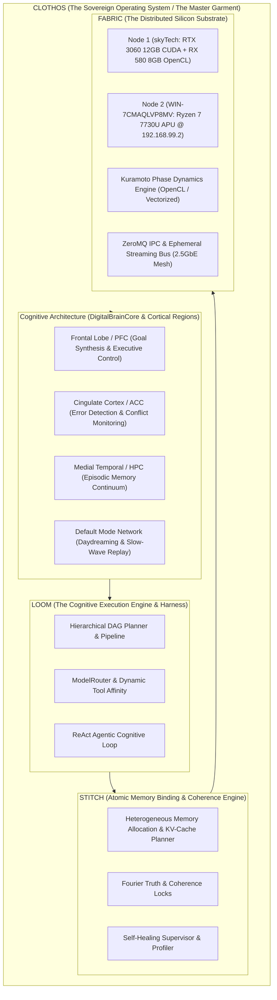

# ClothOS: Sovereign Cognitive Operating System Architecture & Precision Tool Ontology

> **Architectural Specification & Metaphorical Unification**  
> **Repository:** `nasakib/loom-fabric`  
> **Platform:** ClothOS Sovereign Operating System (Loom / Fabric / Stitch / Torque)  
> **Hardware Mesh:** Heterogeneous Cluster (Local: Discrete NVIDIA RTX 3060 12GB CUDA + AMD Radeon RX 580 8GB OpenCL; Remote: Ray Cluster Head Node `WIN-7CMAQLVP8MV` AMD Ryzen 7 7730U APU @ `192.168.99.2:6379`)

---

## 1. Macro-System Architecture: The Weaving Ontology

ClothOS is structured as a living computational garment. In Greek mythology, **Clotho** is the Fate who spins the thread of human destiny; in computing, ClothOS is the sovereign operating system that weaves hardware, distributed intelligence, and constitutional ethics into a unified fabric.

### The Primary Pillars

| Component | Physical Weaving Metaphor | Software Architectural Implementation | Primary Module Path | Status |
| :--- | :--- | :--- | :--- | :--- |
| **CLOTHOS** | **The Tailored Garment** | The sovereign operating system runtime. Holds user identity, active steering, system telemetry, and coordinates multi-agent cognition. | `loom/clothos/kernel.py` `loom/weaving/cloth.py` | **Implemented** |
| **LOOM** | **The Weaving Apparatus** | The master execution harness. Holds warp threads under tension, cycles harnesses, and interlaces dynamic weft threads through task DAGs. | `loom/weaving/loom.py` `loom/pipeline.py` | **Implemented** |
| **FABRIC** | **The Woven Mesh** | The distributed physical silicon substrate. Bridges heterogeneous compute nodes into a unified memory pool (~40 GB local host + 31.3 GB Node 2 + 20 GB GPU VRAM) over 2.5GbE mesh (~285 MB/s effective). | `loom/weaving/fabric.py` `loom/fabric/` | **Implemented** |
| **STITCH** | **The Binding Needlework** | The state coherence and virtual memory planner. Connects separate threads, plans layer placements, catches runtime OOM exceptions, and performs self-healing. | `loom/weaving/stitch.py` `loom/stitch/` | **Implemented** |
| **TORQUE** | **The Enclave Drive** | Zero-trust security enclave with reversible regex/Aho-Corasick PII and IP scrubbers, `RehydrationVault`, and egress URL validation firewall. | `loom/torque/enclave.py` | **Implemented** |

---

## 2. Elementary Weaving Data Entities

1. **Warp Threads (Stationary Invariants):**
   * *Physical Metaphor:* The vertical threads strung tightly on the loom under continuous tension (lifted and depressed by harnesses).
   * *Software Equivalent:* Immutable system axioms, physical conservation laws, mathematical ground truth, and the constitutional fiduciary mandate (`loom/weaving/threads.py`).
2. **Weft Threads (Dynamic Inputs & Observations):**
   * *Physical Metaphor:* The lateral threads carried back and forth through the warp shed by the shuttle.
   * *Software Equivalent:* Runtime operator prompts, external tool observations, intermediate agent thoughts, and dynamic token streams.
3. **The Shuttle (High-Velocity IPC & Data Transport):**
   * *Physical Metaphor:* The aerodynamic wooden projectile that carries the weft spindle across the open shed in milliseconds.
   * *Software Equivalent:* ZeroMQ socket streaming bus and direct TCP transport transferring serialized states across the local and remote Ray nodes over 2.5GbE mesh (`loom/weaving/shuttle.py`).
4. **The Tear (Exceptions, Drift & Leaks):**
   * *Physical Metaphor:* A broken warp or frayed weft creating a hole in the cloth.
   * *Software Equivalent:* Out-of-memory errors, context overflows, or hallucination divergence, caught and mended by the Stitch Engine (`loom/weaving/tear.py`).

---

## 3. The Precision Machine Tool Ontology

ClothOS unifies 11 mechanical workshop tools into algorithmic, procedural software operators within `loom/tools/` and `loom/torque/`. Each tool maps a physical mechanical capability to its exact algorithmic software equivalent:

```mermaid
classDiagram
    class SovereignToolbox {
        +TorqueEnclave torque
        +RatchetEngine ratchet
        +WrenchCoupler wrench
        +DrillInspector drill
        +ViseLock vise
        +LatheShaper lathe
        +CaliperGauge caliper
        +ChiselAblator chisel
        +TapDieThreader tap_die
        +WinchHoist winch
        +HammerForge hammer
        +BullshitMeter bullshit_meter
        +FiduciaryMandateGuard fiduciary
        +get_full_tooling_status() Dict
    }

    class CaliperGauge {
        +measure_error_margin(candidate, ground_truth, epsilon) Dict
        +gauge_routing_entropy(probabilities, threshold) Dict
        +verify_pii_purity(text, sensitive_patterns) Dict
    }
    class ChiselAblator {
        +ablate_context(prompt_text, max_chars, preserve_code_blocks) str
        +slice_ast_definition(source_code, target_symbol) str
    }
    class DrillInspector {
        +bore_vertical_trace(prompt, target_model) Dict
        +probe_proof_depth(axiom_id, max_depth) Dict
    }
    class HammerForge {
        +forge(weights, bits, tensor_id) QuantizedTensorResult
        +rivet(axiom_id, invariant_payload, hardware_csr) RivetSeal
        +smash_deadlock(target_identifier, resources_to_free) SmashResult
        +dead_blow(state_vector, impulse_scale, damping) DeadBlowResult
        +peen_stress_test(buffer_size_bytes, cycles) MemoryStressTestResult
    }
    class LatheShaper {
        +turn_embeddings(vectors, target_dim) np.ndarray
        +balance_kuramoto_oscillators(phases) Dict
    }
    class RatchetEngine {
        +click(axiom_id, description, proof_payload, confidence) bool
        +rotate_key(key_id, new_value) Dict
        +preemption_catch(cycle, oscillator_offset, payload) str
        +release_catch() Optional
        +free_energy_diode(delta_free_energy, delta_coherence) bool
    }
    class TapDieThreader {
        +tap_socket_endpoint(host, port, transport) str
        +die_payload(payload_dict, topic) bytes
        +verify_and_unwrap(framed_payload) Tuple
    }
    class ViseLock {
        +clamp(resource_id, timeout_sec) Generator
        +lock_pmp_napot(base_addr, size_bytes) Dict
    }
    class WinchHoist {
        +calculate_mechanical_advantage(source_tier, target_tier) float
        +hoist_workload(task_id, payload, source_tier, target_tier) Dict
        +spool_down(task_id, result_data, destination_tier) Dict
    }
    class WrenchCoupler {
        +tighten_schema(raw_dict, target_model_cls) BaseModel
        +clamp_temperature(task_domain) float
        +torque_joint(primary_state, secondary_state, max_skew) Dict
    }
    class TorqueEnclave {
        +tokenize_sensitive_data(text) Tuple
        +rehydrate_sanitized_text(anonymized_text) str
        +evaluate_egress_safety(endpoint_url) bool
    }

    SovereignToolbox *-- CaliperGauge
    SovereignToolbox *-- ChiselAblator
    SovereignToolbox *-- DrillInspector
    SovereignToolbox *-- HammerForge
    SovereignToolbox *-- LatheShaper
    SovereignToolbox *-- RatchetEngine
    SovereignToolbox *-- TapDieThreader
    SovereignToolbox *-- ViseLock
    SovereignToolbox *-- WinchHoist
    SovereignToolbox *-- WrenchCoupler
    SovereignToolbox *-- TorqueEnclave
```

### Detailed Metaphorical Matrix

| # | Tool | Physical Workshop Definition | Software Algorithmic & Procedural Implementation | File Path | Status |
| :-: | :--- | :--- | :--- | :--- | :--- |
| **1** | **Caliper** | Vernier measuring instrument determining dimensions down to ~0.02 mm tolerance. | **Precision Metrology & Entropy Gauging:** Computes $L_2$, Chebyshev, and Cosine divergence between candidate outputs and ground truth down to $\epsilon = 10^{-5}$; measures Shannon routing entropy to evaluate Crisp vs. Diffuse decision distribution. | `loom/tools/caliper.py` | **Implemented** |
| **2** | **Chisel** | Bevelled cutting wedge driven by hand or mallet to chip away unwanted material with surgical control. | **Surgical Context Ablation & AST Extraction:** Prunes conversational fluff from prompts while preserving code fences and equations; extracts targeted function and class AST definitions via Python `ast`. | `loom/tools/chisel.py` | **Implemented** |
| **3** | **Drill** | Fluted rotating cutting bit penetrating perpendicularly into dense strata. | **Vertical Borehole Deep-Prober:** Bores through 5 abstraction tiers: **L0** (Semantic Ingress) $\to$ **L1** (Latent Space) $\to$ **L2** (Heterogeneous Sharding) $\to$ **L3** (Physical Silicon VRAM/RAM) $\to$ **L4** (Silicon PMP CSR emulation). Probes inductive proof depth. | `loom/tools/drill.py` | **Implemented** (L0-L3 dynamic; L4 simulated) |
| **4** | **Hammer** | Weighted percussive tool delivering instantaneous momentum ($\Delta p = \int F dt$). | **Kinetic Impulse & Forging Engine:** Cold-forges weight matrices into INT4 and ternary representations with Frobenius error tracking; drives permanent cryptographic rivets into WORM state; frees held locks on deadlock; injects dead-blow non-ringing stochastic shock to escape local minima; stress-tests RAM bus integrity. | `loom/tools/hammer.py` | **Implemented** |
| **5** | **Lathe** | Machine tool rotating a workpiece against a cutting blade to produce symmetrical cylinders. | **Latent Manifold Turning & SVD Balancing:** Spins high-dimensional embeddings through SVD centering and principal subspace projection onto the unitary hypersphere ($L_2 = 1.0$), eliminating common-mode anisotropic drift while strictly preserving pairwise semantic cosine similarity; balances Kuramoto oscillator phases. | `loom/tools/lathe.py` | **Implemented** |
| **6** | **Ratchet** | Toothed wheel with a pivoted spring pawl permitting forward motion only. | **Monotonic Progress Pawl:** Enforces forward state progression ($d\mathcal{K}/dt \ge 0$ where $\mathcal{K}$ is ratified invariant knowledge). Click advances SHA-256 chained axiom ledger; free-energy diode blocks state changes that increase free energy; preemption catch stores thread snapshots. | `loom/tools/ratchet.py` | **Implemented** |
| **7** | **Tap & Die** | Complementary threading tools: Tap cuts internal female threads; Die cuts external male threads. | **Heterogeneous Protocol Framing:** Tap formats structured socket connection endpoints; Die packages structured payloads with struct-based binary framing headers (magic bytes, CRC32 checksum, topic, payload size), verified and unwrapped upon arrival. | `loom/tools/tap_die.py` | **Implemented** |
| **8** | **Vise** | Heavy mechanical bench clamp holding workpieces in fixed immobility. | **Atomic Workholding & Concurrency Freeze:** Context manager clamps volatile AST nodes and critical memory resources under `threading.RLock`; generates simulated RISC-V Physical Memory Protection configuration (`pmpcfg0` CSR 0x3A0, byte `0x9D` locked NAPOT Read+Exec). | `loom/tools/vise.py` | **Implemented** (Locking real; PMP simulated) |
| **9** | **Winch** | Mechanical drum and spool providing compound mechanical advantage to hoist heavy loads. | **Distributed Workload Elevation:** Calculates mechanical compute advantage ratios across tiered nodes (CPU $\to$ Local GPU $\to$ Cluster Ray $\to$ Cloud); constructs tensioned workload elevation manifests; spools completed token results back to origin. | `loom/tools/winch.py` | **Implemented** (Manifests real; cluster dispatch via Ray) |
| **10** | **Wrench** | High-leverage tool applying rotational torque to clamp fasteners tightly together. | **High-Leverage Schema Clamping & Joint Coupling:** Clamps elastic JSON model outputs into rigid, validated Pydantic models (pruning hallucinatory extra fields); clamps temperature by domain (0.0 for proofs, 0.7 for creative generation); torques state joints between nodes. | `loom/tools/wrench.py` | **Implemented** |
| **11** | **Torque** | Rotational twisting force applied around a central axis ($\tau = r \times F$). | **Rotational Security Enclave & Dynamic Triage:** Reversible regex tokenization of PII and IP into cryptographic vault tokens (`<VAULT_TOKEN_...>` markers); rehydrates inbound responses; evaluates egress endpoint safety via firewall rulebook. | `loom/torque/enclave.py` | **Implemented** |

---

## 4. Cognitive, Epistemic, and Conscientious Suites

Beyond workshop tools, ClothOS integrates high-order cognitive and safety engines:

| Suite | Software Purpose & Mechanism | Module Path | Status |
| :--- | :--- | :--- | :--- |
| **Epistemic Reality Guard ("Bullshit Meter")** | Mathematical and physical truth-verification engine. Flags ungrounded buzzwords, circular definitions, superluminal velocities ($v > c$), Landauer erasure violations ($E < k_B T \ln 2$), and unnormalized probabilities. Produces quantitative *Rubbish Score* ($0.0$ to $1.0$). **Fails-closed on error.** | `loom/tools/epistemic_grounding.py` | **Implemented** |
| **Constitutional Fiduciary Guard** | Existential safety kernel. Vetoes deceptive alignment, unauthorized data exfiltration, destructive filesystem wipes, and non-fiduciary directives. Axiom: *"Human life valued above system existence infinitely."* **Fails-closed on error.** | `loom/tools/fiduciary_guard.py` | **Implemented** |
| **Truth-Based Imagination Engine** | Generative hypothesis speculation anchored to an empirical non-fiction ground truth manifold $\mathcal{M}_{\text{truth}}$. Audits speculative extrapolations through Epistemic and Fiduciary guards before acceptance. | `loom/tools/truth_imagination.py` | **Implemented** |
| **Temporal Cognition Suite** | Three-fold temporal cognition: **Hindsight** (memory replay distilling noisy traces into invariants), **Insight** (active deductive reasoning), and **Foresight** (predictive rollouts and error forecasting). | `loom/tools/temporal_cognition.py` | **Implemented** |
| **Crystallized Memory Suite** | Dense associative Modern Hopfield networks providing exponential pattern recall capacity $\Omega(2^{d/2})$ (Demircigil et al., 2017). Offloads crystallized patterns from RAM into disk vaults. | `loom/tools/crystallized_memory.py` | **Implemented** |
| **Software Genetics Engine** | Evolutionary code mutation and natural selection: evaluates algorithmic genomes across fitness functions with crossover and point mutations under strict Landauer bounds. | `loom/tools/genetics_tool.py` | **Implemented** |
| **Hardware Compute Engine (RX 580)** | Direct native OpenCL 2.0 dispatch via `ctypes` driving 36 compute units (2048 stream processors) on AMD Radeon RX 580 for Kuramoto dynamical sweeps and 2D Gram matrix cosine similarity, with vectorized CPU fallback. | `loom/fabric/rx580_compute.py` | **Implemented** |

---

## 5. Verification Matrix & Test Coverage

All core tools and cognitive engines are verified with automated test suites (`tests/test_sovereign_tools.py`):

1. **Ratchet Monotonicity:** Verifies forward axiom registration, immutability against regression, thermodynamic free-energy diode, and preemption catch/restore.
2. **Wrench Coupling:** Verifies strict Pydantic model clamping, temperature clamping, and joint synchronization.
3. **Drill Vertical Trace:** Verifies 5-tier trace penetration, dynamic host memory measurement, and simulated PMP configuration (`pmpcfg0` CSR 0x3A0 / byte `0x9D`).
4. **Vise Workholding:** Verifies reentrant atomic context manager locking and PMP NAPOT freeze.
5. **Lathe SVD Shaper:** Verifies $L_2 = 1.0$ unitary hypersphere normalization and **demonstrates preserved cosine similarity ($> 0.95$) for near-duplicate embeddings**.
6. **Caliper Metrology:** Verifies $L_2$ error tolerance, Shannon entropy decision gating, and PII purity checking.
7. **Chisel Ablation:** Verifies prompt filler trimming and accurate AST symbol extraction.
8. **Tap & Die Protocol:** Verifies socket endpoint formatting and binary-framed payload packing/unwrapping.
9. **Winch Hoisting:** Verifies multi-tier compute ratio calculations and workload elevation manifest creation.
10. **Hammer Forge & Impulse:** Verifies INT4/ternary weight quantization with Frobenius error tracking, irreversible WORM rivets, and kinetic deadlock resolution.
11. **Fiduciary Guardrail:** Verifies active detection and fail-closed vetoing of destructive filesystem wipes and credential exfiltration.
12. **Epistemic Reality Guard:** Verifies detection and rejection of pseudoscience buzzwords, superluminal claims, and unphysical parameters.
