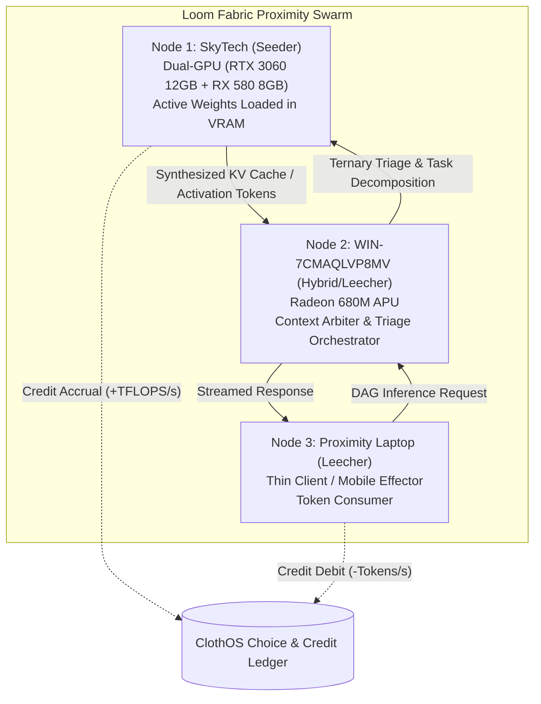

# Loom Fabric P2P Distributed Compute Specification
**Subsystem:** ClothOS Core Mesh / Loom Fabric  
**Authority:** VectorCore Holdings / BRAND  
**Standard:** SCDP-01 (Sovereign Compute Distribution Protocol)  
**Classification:** Sovereign Distributed Systems Architecture  

---

## 1. Executive Summary & Vision

The **Loom Fabric Sovereign P2P Compute Network** is a decentralized, proximity-aware compute distribution mesh designed to democratize high-throughput artificial intelligence inference and training. Drawing on foundational peer-to-peer (P2P) paradigms pioneered by BitTorrent (tit-for-tat, seeders, leechers) combined with ClothOS's **Polymorphic Radix Engine** (Dozenal Base-12 compute scheduling and Balanced Ternary Base-3 state transitions), Loom Fabric enables individuals within physical proximity (LAN, Wi-Fi 6, campus fiber) or secure virtual overlays (Tailscale, WireGuard) to pool their heterogeneous compute resources into an elastic, sovereign supercomputer.

---

## 2. Network Roles: Seeders, Leechers & Hybrid Nodes

Every node running the Loom Fabric daemon acts as an autonomous participant in the swarm:

### 2.1 The Seeder
- **Definition:** A node that advertises available VRAM, Tensor/Compute Cores, or CPU RAM to the mesh and actively serves model weights, KV caches, or forward-pass tensor layers.
- **Incentive:** Earns **Compute Credits ($\Xi$)** based on:
  $$\Xi = \int \left( \alpha \cdot \text{VRAM}_{\text{committed}} + \beta \cdot \text{TFLOPS}_{\text{delivered}} + \gamma \cdot \frac{1}{\text{RTT}_{\text{ms}}} \right) dt$$
- **Operational States:**
  - *Full Seeder:* Entire model weights (e.g., `loom-sovereign-70b`) permanently retained in GPU/Host RAM.
  - *Pipeline Seeder:* Hosts a contiguous block of transformer layers (e.g., layers 16–32) in pipeline-parallel (PP) sharding.
  - *Ephemeral Seeder:* Donates compute during user inactivity or screensaver modes (`Launch-Loom-Screensaver.bat`).

### 2.2 The Leecher
- **Definition:** A node submitting inference prompts, fine-tuning jobs, or DAG execution workloads exceeding its native hardware envelope.
- **Credit Consumption:** Consumes credits at the prevailing network compute clearing rate.
- **Dynamic Tit-for-Tat Enforcement:** If a leecher exhausts its credit balance and offers zero reciprocity (refusing to seed during idle cycles), its traffic is downgraded to background best-effort tier or throttled according to Choke/Unchoke algorithms.

### 2.3 The Hybrid (Pro-Consumer)
- Default state for standard installations (e.g., Node 2 `WIN-7CMAQLVP8MV`). Conducts local inference for small models (3B/7B) while offloading dense 70B layers to proximate seeders, concurrently seeding its APU for embedding generation or audio synthesis.

---

## 3. Proximity-Aware Discovery & Latency Topology

Modern distributed tensor operations are strictly bounded by interconnect latency. Loom Fabric establishes a multi-tiered topology hierarchy:

| Tier | Physical Medium | Typical Latency | Protocol | Permissible Parallelism |
| :--- | :--- | :--- | :--- | :--- |
| **Tier 0 (Intra-Node)** | PCIe 4.0 / NVLink / Host RAM | $< 0.1\,\mu\text{s}$ | Zero-Copy UMA / Direct CUDA-HIP | Tensor Parallelism (TP), DeepSpeed ZeRO-3 |
| **Tier 1 (Proximity LAN)** | 2.5G/10G Ethernet, Wi-Fi 6 Direct | $0.2 - 2.0\,\text{ms}$ | RDMA over Converged Ethernet (RoCE), raw TCP/gRPC | Pipeline Parallelism (PP), Layer Sharding |
| **Tier 2 (Campus/MAN)** | Dedicated Fiber, Metro Tailscale | $2.0 - 15.0\,\text{ms}$ | QUIC / ZeroMQ Stitch Bridge | Speculative Verification, Batch Prefill Offload |
| **Tier 3 (Wide-Area WAN)** | Internet / Overlay VPN | $> 15.0\,\text{ms}$ | Asynchronous DAG RPC | Independent Agent Tasks, R&D Hypotheses |

### Discovery Mechanism
1. **mDNS / Bonjour Broadcast:** Ambient discovery over local subnets using service definition `_loom-fabric._tcp.local`.
2. **Deterministic Tailnet Pairing:** Direct peer-to-peer WireGuard tunnels over Tailscale (`100.x.y.z`) eliminating NAT traversal hurdles.
3. **Hardware Capability Attestation:** On handshake, peers exchange signed attestation manifests verifying:
   - Compute backend (`cuda`, `rocm`, `vulkan`, `opencl`, `cpu`)
   - Quantization engines supported (`GGUF`, `EXL2`, `AWQ`, `FP8`)
   - Net Landauer energy efficiency rating ($pJ / \text{MAC}$).

---

## 4. Compute Sharding & Scheduling: Radix-Balanced Allocation

In accordance with the **ClothOS Sovereign Architecture**:
- **Dozenal Base-12 Batching:** Request batches and pipeline microbatches are allocated in dozenal units ($12^0=1, 12^1=12, 12^2=144$) to maximize cache alignment across GPU warp boundaries ($32/64$).
- **Balanced Ternary State Triage ($T = \{-1, 0, +1\}$):**
  - $+1$ (Surplus/Seeder Mode): Node advertises compute capacity to neighbors.
  - $0$ (Equilibrium): Node operates self-sufficiently on local hardware.
  - $-1$ (Deficit/Leecher Mode): Node dynamically requests pipeline shards from the swarm.

---

## 5. Verification, Integrity & Immune Memory (CRISPR Spacers)

To prevent poisoning, Sybil attacks, or hallucinated outputs from rogue peers:
1. **Deterministic KV Proof-of-Inference (PoI):** Random verification layers generate cryptographic commitments of intermediate tensor activations.
2. **BabelForge Invariant Validation:** Any DAG graph generated across distributed subgraphs must pass native `validate_graph_invariants` checks prior to token stream commit.
3. **CRISPR Immune Spacer Ledger (`.clothos_learned_patterns.json`):** Faulty nodes that emit NaN activations, memory leaks, or protocol non-conformances have their cryptographic identity hashed and permanently isolated into the immune exclusion ledger.

---

## 6. Commercialization Roadmap: From Local Mesh to Global Compute Exchange

1. **Phase 1: Local Sovereign Mesh (Current):** Dual-node LAN/Tailnet pooling between `skyTech` and `WIN-7CMAQLVP8MV`.
2. **Phase 2: OpenClaw Native Provider Plugin:** Seamless auto-discovery and model picker integration directly in OpenClaw Companion and Web GUI.
3. **Phase 3: Proximity P2P Clustering:** Automated zero-configuration cluster formation for coworking spaces, academic labs, and household devices.
4. **Phase 4: Sovereign Compute Marketplace:** Fiat and crypto-settled clearinghouse allowing compute providers to monetize excess GPU cycles with strict zero-exfiltration covenants under the **SCDL-1.0**.
