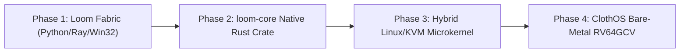

# ClothOS Roadmap: Evolution from Loom Fabric to RISC-V Unikernel

> **Target Platform**: Bare-Metal RISC-V RV64GCV Silicon  
> **Kernel Architecture**: Capability-Based `no_std` Microkernel / Unikernel in Rust  
> **Acceleration Target**: Custom Systolic Array TPU Coprocessors + Vector Extensions (RVV 1.0)

---

## 1. Architectural Motivation

Modern AI operating systems suffer from severe layers of legacy abstraction:
- Linux/Windows virtual memory paging (`mmap`) introduces TLB shootdowns and non-deterministic latency.
- PCI Express driver communication requires multiple user-to-kernel memory copies.
- Operating system schedulers treat matrix multipliers as opaque peripheral accelerators rather than first-class compute pipelines.

**ClothOS** eliminates the OS tax entirely by making **Tensor Memory (`tmap`)** and **Systolic Matrix Multiplies** the native primitives of the kernel itself.

---

## 2. Phase-by-Phase Evolution

### Phase 1: Loom Fabric (Current Baseline)
- Multi-node heterogeneous orchestration across Windows 11 (CUDA/Vulkan) and Head Node (Ryzen 7).
- Mathematical layer allocation, zero-trust Torque enclaves, Win32 Job Object lifecycle guards, and Ray mesh communication.
- Strict functional contracts in Python mimicking Rust traits (`typing.Protocol`) and frozen Pydantic DTOs.

### Phase 2: `loom-core` (Native Rust Crate)
- Port pure computational subsystems into a unified `no_std`-compatible Rust library:
  - `loom-types`: Core immutable DTOs and result wrappers.
  - `loom-torque`: Zero-trust regex/Aho-Corasick enclave scrubber and `RehydrationVault`.
  - `loom-stitch`: Zero-OOM mathematical allocator calculating layer splits and KV-cache footprints.
- Replace HTTP loopback overhead with lock-free shared memory ring buffers (`shm_open`).

### Phase 3: Hybrid Microkernel Emulation
- Deploy `loom-core` within a minimal hypervisor environment (KVM / Cloud-Hypervisor).
- Implement `tmap`: Hardware-assisted PagedAttention integrated directly into virtual address space translation.
- Replace process boundaries with capability tokens (seL4-style capability architecture).

### Phase 4: ClothOS Bare-Metal on RISC-V
- Target hardware: **RISC-V RV64GCV** (RV64I + M + A + F + D + C + Vector 1.0 with $VLEN=512$).
- Pure `no_std` unikernel bootloader initialized via OpenSBI (Supervisor Binary Interface).
- Systolic TPU instructions mapped to custom RISC-V opcode extensions (e.g., `tpu.matmul.f16`).
- Physical memory partitioned directly into:
  1. Kernel text & capability tables ($\le 16\text{ MB}$).
  2. Weight matrices (continuous physically contiguous pages).
  3. Dynamic KV-cache ring buffers.

---

## 3. RISC-V RVV & Systolic Hardware Co-Design

| Feature | Standard OS + Driver | ClothOS Native Microkernel |
| :--- | :--- | :--- |
| **Memory Architecture** | 4KB / 2MB POSIX Virtual Pages | 64MB Contiguous Tensor Tiles (`tmap`) |
| **Driver Boundary** | User Space $\to$ Kernel $\to$ Hardware | Zero-Copy Capability Ring Buffer |
| **Security Enclave** | Userspace Regex Scrubber | Hardware Page-Permission Cryptographic Enclave |
| **Vector Registers** | $VLEN=128\text{ bits}$ (Scalar Fallback) | $VLEN=512\text{ bits}$ with Systolic Coprocessor |
| **Latency to First Token** | 15–40 ms OS Dispatch Overhead | $< 1.2\text{ ms}$ Direct Core Interrupt |
