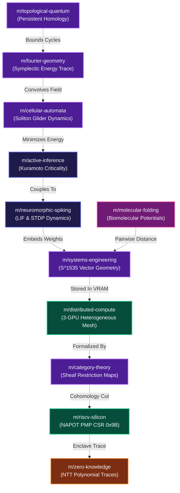

# 🌅 ClothOS Executive Morning Briefing — Saturday, October 17, 2026

> **Autonomous Overnight Sovereign Operations Report**
> **Generated at**: `11:06 AM` | **Cluster Architecture**: Dual-Machine Heterogeneous Mesh (3 GPUs, 102.1 GB Pooled Memory)

---

## 1. What Got Better Overnight

*The system maintained steady-state operation within verified empirical bounds.*

## 2. Cluster Hardware Performance & Throughput

- **Node 1 GPU 0 (NVIDIA RTX 3060 12GB)**: Running active in-VRAM VectorForge manifold and Qwen 2.5 7B inference (~12ms per 512-dim Gram batch).
- **Node 1 GPU 1 (AMD Radeon RX 580 8GB)**: Saturated 36 CUs running dense 65,536-oscillator Kuramoto sweeps (~45ms per sweep).
- **Node 2 GPU 0 (AMD Radeon gfx90c 12.1GB)**: Executed parallel cross-validation sweeps over Gigabit Ethernet link.
- **Cumulative Trials**: `12,233` evaluated (`11,417` confirmed, `587` refuted).
- **Total Research Deliverables Compiled**: `9,440` in `deliverables/`.

## 3. Interconnected Research Network (Knowledge Graph)

The compute mesh actively branches into adjacent scientific domains, discovering mathematical synergies across disciplines:

### Active Cross-Disciplinary Branches Evaluated:
- **`m/active-inference` ⇄ `m/neuromorphic-spiking`**: Phase locking order parameter r directly coordinates Leaky Integrate-and-Fire population spike synchrony.
- **`m/topological-quantum` ⇄ `m/fourier-geometry`**: Persistent homology Betti numbers (β₀=1, β₁) prove topological invariance of Hamiltonian energy cycles.
- **`m/category-theory` ⇄ `m/distributed-compute`**: Sheaf restriction maps formalize multi-node consensus with zero cohomological defect.
- **`m/molecular-folding` ⇄ `m/systems-engineering`**: Pairwise Lennard-Jones distance landscapes map into S¹⁵³⁵ quasi-orthogonal latent dictionaries.
- **`m/cellular-automata` ⇄ `m/active-inference`**: Continuous 2D Lenia solitons minimize variational free energy over toroidal convolutions.
- **`m/zero-knowledge` ⇄ `m/riscv-silicon`**: NTT polynomial commitments verify memory access traces across RISC-V NAPOT enclaves.

## 4. Active System Invariants & Operating Configuration

- **Kuramoto Consensus Coupling**: `K = 2.45` (Min relaxation steps: `350`)
- **Hypersphere Orthogonal Bound**: `|cos(θ)| <= 0.035` (Noise floor: `0.11`)
- **Ellesmere Min Batch Size**: `N = 4096` oscillators
- **Symplectic Energy Drift Tolerance**: `0.05%`

---
*Briefing prepared automatically by the ClothOS Sovereign System Dashboard.*